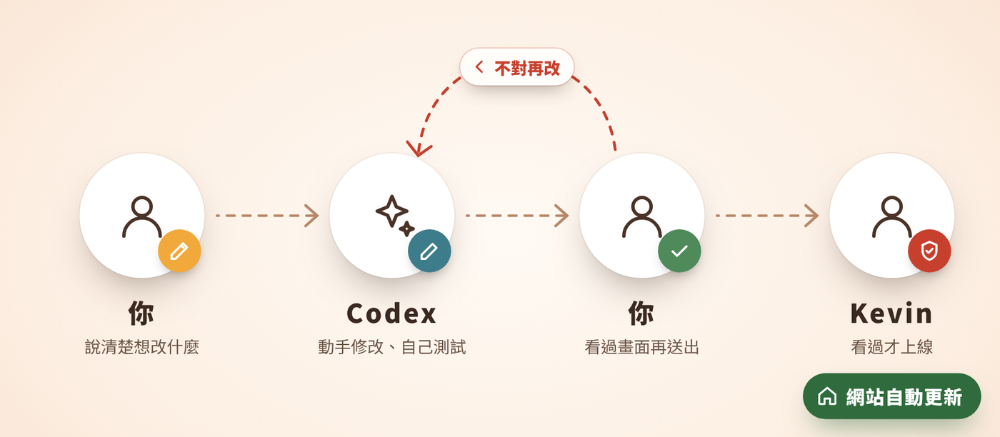
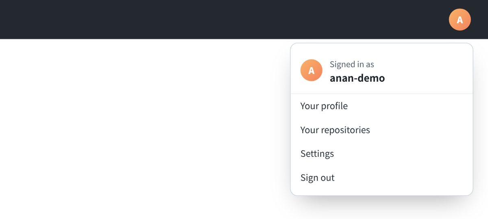
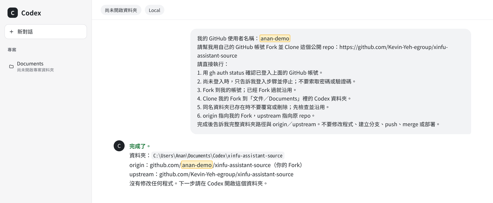
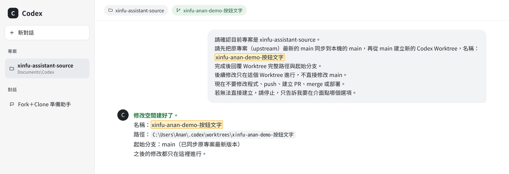
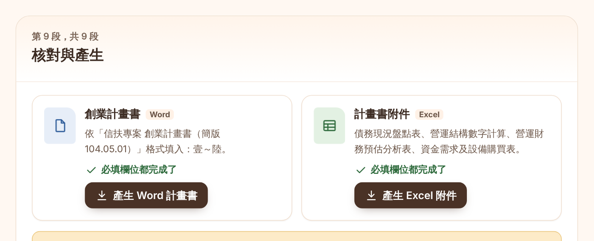
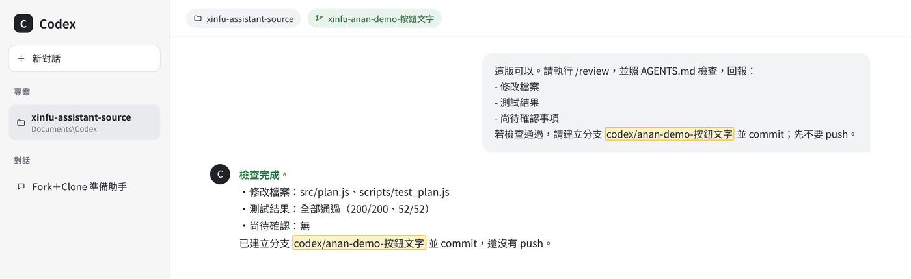
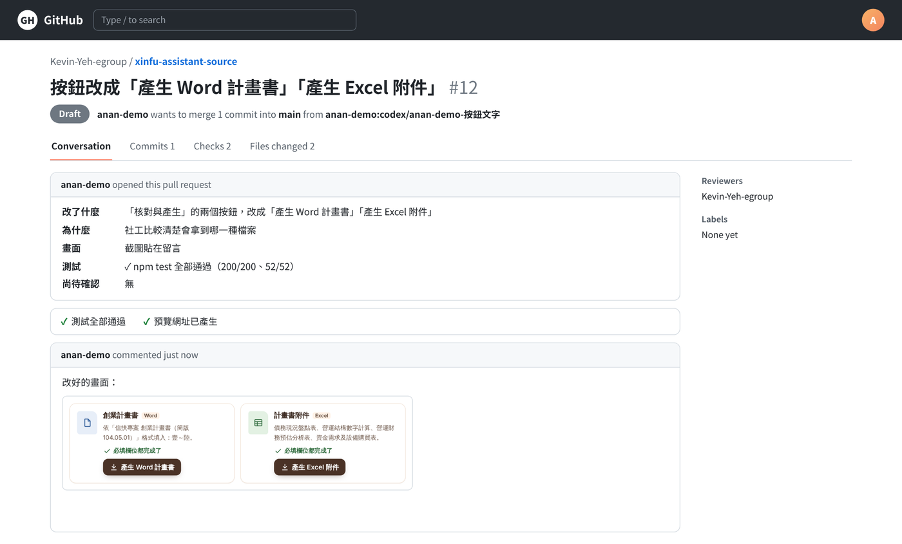

# 創業貸款準備助手｜夥伴修改操作說明

照著做，你就能自己動手改準備助手：你把想改的地方說清楚，Codex 幫你改、幫你測試，Kevin 看過才上線。不確定怎麼做，先看[教學影片：夥伴修改篇（約 3 分鐘）](https://xinfu-assistant.vercel.app/videos/partner-guide.mp4)。

## 先看這裡

修改分三段：準備（只做一次）→ 修改（說清楚、看清楚）→ 送交（Kevin 把關）。你負責說清楚和看畫面，動手和測試交給 Codex。



- 下面每一段灰底文字都是要貼給 Codex 的，整段複製、貼上就好；［　］的地方換成你自己的內容。
- 要改的是準備助手的原始檔，放在 GitHub 的這個專案：[xinfu-assistant-source](https://github.com/Kevin-Yeh-egroup/xinfu-assistant-source)。
- 文中的 Codex、GitHub 畫面都是示意，實際畫面可能長得不太一樣，照著字找按鈕即可。

三個原則：

1. 密碼和驗證碼只在 Google、GitHub 的畫面輸入，不要貼給 Codex。
2. 只在自己的「修改空間」裡改，送出前先自己看過畫面。
3. 你送出的是「草稿」，要不要上線由 Kevin 決定。

## 開始前：註冊 GitHub、裝好 Codex（只做一次）

1. 打開 [github.com/signup](https://github.com/signup)，註冊方式一律點「Continue with Google」。
2. 選自己要用來協作的 Google 帳號。
3. 照 GitHub 的畫面完成免費帳號（Personal account）的設定與驗證。
4. 登入後點右上角的頭像，記下自己的使用者名稱（username）。

我的 GitHub 使用者名稱：＿＿＿＿＿＿＿＿＿＿



第一次使用前，請 Kevin 幫你確認電腦裝好這四個程式：Codex 桌面版（用公司規定的帳號登入）、Git、GitHub CLI、Node.js。

Codex 問「要不要允許」時：安裝工具、執行測試、啟動預覽、送出草稿，按允許；合併、部署、刪除檔案，先不要，問 Kevin。

## 第 1 步：把準備助手複製到自己的電腦

在 Codex 開一個新對話，把第一行換成你的使用者名稱，整段貼上：

```text
我的 GitHub 使用者名稱：［填入自己的 GitHub 使用者名稱］
請幫我用自己的 GitHub 帳號 Fork 並 Clone 這個公開 repo：https://github.com/Kevin-Yeh-egroup/xinfu-assistant-source
請直接執行：
1. 用 gh auth status 確認已登入上面的 GitHub 帳號。
2. 尚未登入時，只告訴我登入步驟並停止；不要索取密碼或驗證碼。
3. Fork 到我的帳號；已經 Fork 過就沿用。
4. Clone 我的 Fork 到「文件／Documents」裡的 Codex 資料夾。
5. 同名資料夾已存在時不要覆寫或刪除；先檢查並沿用。
6. origin 指向我的 Fork，upstream 指向原 repo。
完成後告訴我完整資料夾路徑與 origin／upstream。不要修改程式、建立分支、push、merge 或部署。
```

**看到這個就完成**：Codex 回覆資料夾的位置，回覆的網址裡有你的使用者名稱。接著在 Codex 按「開啟資料夾（Open folder）」，選它回覆的那個資料夾。



## 第 2 步：開一個自己的修改空間

每次要改新的東西，都從這一步開始。填好使用者名稱和這次的主題（例如「按鈕文字」），整段貼上：

```text
請確認目前專案是 xinfu-assistant-source。
請先把原專案（upstream）最新的 main 同步到本機的 main，再從 main 建立新的 Codex Worktree，名稱：
xinfu-［我的 GitHub 使用者名稱］-［修改主題］
完成後回覆 Worktree 完整路徑與起始分支。
後續修改只在這個 Worktree 進行，不直接修改 main。
現在不要修改程式、push、建立 PR、merge 或部署。
若無法直接建立，請停止，只告訴我要在介面點哪個選項。
```

**看到這個就完成**：Codex 回覆修改空間（Worktree）的位置，畫面上方出現它的名稱。在這裡怎麼改，都不會影響大家。

Codex 說沒辦法直接建立時：先請它「把原專案最新的 main 同步到本機的 main」，再照它說的在畫面上點：新對話 → Worktree → main（正式版本）。

第 3～6 步都貼在這個修改空間的對話裡。



## 第 3 步：用四句話說清楚想改什麼

建議寫得越清楚，Codex 改得越準。先用這四句話整理：

| 句子 | 寫什麼 | 範例 |
| --- | --- | --- |
| 在哪裡 | 哪個版本、哪一頁、哪個按鈕或哪段文字 | 引導員版 →「計畫書與附件」→ 最後一段「核對與產生」 |
| 現在 | 現在看到的樣子 | 按鈕寫「產生計畫書」「產生附件」 |
| 希望 | 想改成什麼樣子 | 改成「產生 Word 計畫書」「產生 Excel 附件」 |
| 原因 | 為什麼這樣比較好 | 社工比較清楚會拿到哪一種檔案 |

把［　］換成整理好的四句話，整段貼上：

```text
請在目前 Worktree 依照以下建議修改「創業貸款準備助手」：
［貼上整理好的四句話］
請先閱讀 AGENTS.md，照裡面的規則修改。
改完請執行 npm test；通過後在背景執行 npm run preview 啟動本機預覽，確認網址打得開再回傳。
建議沒有提到的部分，請不要改動資料保存方式、審查通行碼、個資處理或網站設定。
現在不要 push、建立 PR、merge 或部署。
```

**看到這個就完成**：Codex 改好、測試都通過，最後回覆 http://127.0.0.1:8765 。

第一次做這一步時，Codex 可能要先安裝執行和測試要用的工具，照它的說明讓它安裝即可。

## 第 4 步：打開網址，自己點點看

- 點 Codex 給的網址（通常是 http://127.0.0.1:8765 ）。審查人員版在網址後面加上 /review，測試通行碼是 TEST-CODE-2468（只能在這個預覽用）。
- 這個網址只有你的電腦看得到，怎麼點都不會影響大家。
- 預覽是一個全新、空白的準備助手；試填時只用虛構的資料。
- 照平常的用法操作一次，確認改得對。



不對的地方，填進下面的［　］再貼給 Codex：

```text
請只修正以下內容：
［貼上要調整的地方］
完成後重新執行測試，並確認本機預覽已經更新（沒有在執行就重新啟動），再回傳網址。
```

滿意了，就把改好的畫面截圖存成檔案，第 7 步會用到：

- Windows：按 Win＋Shift＋S 框選。Windows 11 會自動存在「圖片＞螢幕擷取畫面」；Windows 10 要點右下角跳出的通知，再按儲存。
- Mac：按 Shift＋Command＋4 框選，圖會存在桌面。
- 只框準備助手的畫面，不要拍到其他視窗或真實資料：送出的草稿大家都看得到。

## 第 5 步：交件前檢查

畫面確認沒問題後，填好使用者名稱和主題（和第 2 步一樣），整段貼上：

```text
這版可以。請執行 /review，並照 AGENTS.md 檢查，回報：
- 修改檔案
- 測試結果
- 尚待確認事項
若檢查通過，請建立分支 codex/［我的 GitHub 使用者名稱］-［修改主題］並 commit；先不要 push。
```

**看到這個就完成**：Codex 列出改了哪些檔案、測試結果，並說已經 commit（把這次的修改存好）。「尚待確認」有寫東西也可以送出，它會寫進送出的說明，Kevin 會一起看。



## 第 6 步：用自己的帳號送出草稿

看完檢查結果後，整段貼上：

```text
請使用我目前登入的 GitHub 帳號送出這次修改：
1. 確認 origin 是我帳號下的 Fork，upstream 是原 repo。
2. 將目前分支 push 到我的 Fork。
3. 從我的 Fork 分支，對原 repo 的 main 建立 Draft PR：標題用中文寫清楚改了什麼；說明照 PR 範本每一欄填寫（「畫面」一欄寫「截圖貼在留言」），最後加上尚待確認事項。
不要 merge，也不要部署。完成後回傳 PR 連結。
```

**看到這個就完成**：Codex 回傳一個連結，開頭是 https://github.com/Kevin-Yeh-egroup/xinfu-assistant-source/pull/ 。送出的是「草稿」（Draft PR），還不會上線。

## 第 7 步：貼上截圖，把連結傳給 Kevin

1. 打開 Codex 給的連結，捲到頁面最下面的留言框。
2. 把第 4 步存好的截圖檔拖進留言框（或點留言框下方的迴紋針選檔案），再按「Comment」。
3. 把下面這段傳給 Kevin：

```text
我已用自己的 GitHub 帳號開好 Draft PR：［貼上 PR 連結］
改好的畫面截圖已經貼在 PR 留言。請 Kevin 審查並決定是否合併。
```



Kevin 合併後，網站約 1 分鐘自動更新。送出失敗時，截圖，並把錯誤訊息原文傳給 Kevin。

## 一定要守住

- 密碼、驗證碼只在 Google、GitHub 的畫面輸入，不要貼給 Codex，也不要寫在建議裡。
- 不貼真實個案資料；舉例請用虛構的名字，例如「陳小美（示範）」。
- 審查人員版的正式通行碼不要寫進建議、Codex 或 PR；本機預覽只用測試通行碼。
- 只送出草稿；不要自己合併，也不要請 Codex 部署。

## 下次要改別的地方

不用重新複製：在 Codex 打開同一個資料夾，從第 2 步開始，換一個新的主題。

## 常見狀況

| 狀況 | 怎麼辦 |
| --- | --- |
| Codex 說 GitHub 還沒登入 | 照它給的登入步驟做；密碼只在 GitHub 的畫面輸入 |
| 網址打不開，或畫面還是舊的 | 先重新整理網頁；還是不行，請 Codex「重新執行 npm run preview，並回傳網址」 |
| 測試沒有通過 | 先不要送出；請 Codex「找出原因並修正，再重新測試」，還是不行就把它的說明傳給 Kevin |
| 想放棄這次修改 | 從第 2 步開一個新的修改空間重來；還沒送出的修改不會影響任何人 |
| 不小心貼了個資或密碼 | 立刻停止這次對話，告訴 Kevin；密碼請馬上到 Google 或 GitHub 改掉 |
